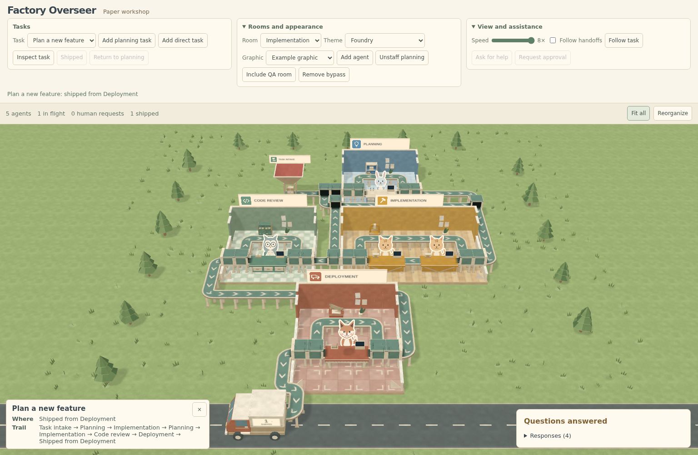

# Factory Overseer

A live paper factory for an agentic system. Pets work at stations in separate
rooms; each task is one box moving along conveyor belts. The host supplies
snapshots, assignments, room transitions and human requests. The factory
shows the work without deciding what happens next.

The default example has an outdoor intake hopper, planning, implementation,
code review and deployment rooms, ending at a delivery truck. Rooms expand
three stations across before adding rows. Signs, paper floors, furniture and
pet artwork are configurable. The four bundled themes include generated
paper furnishings with retained sources and reproducible Blender exports.



## Run locally

Every project command runs inside the devcontainer. With Docker and the
[devcontainer CLI](https://github.com/devcontainers/cli) installed:

```bash
devcontainer up --workspace-folder .
devcontainer exec --workspace-folder . bun run dev
```

Open <http://localhost:3000>. In VS Code, **Reopen in Container** runs the same
environment.

| Command inside the devcontainer | Purpose |
| --- | --- |
| `bun run dev` | Demo on port 3000 |
| `bun run build` | Production demo build |
| `bun run test` | Pure unit tests; no WebGL |
| `bun run typecheck` | TypeScript checks |
| `bun run smoke` | Deterministic Chromium browser tests; evidence in `test-results` |

The browser suite starts its own server on port 3100. It can run alongside
the demo. See [integrated verification](docs/screenshots/integrated-demo/README.md)
for the focused acceptance command, current screenshots and measured limits.

## Try the complete flow

1. Keep **Plan a new feature** selected and choose **Send to Planning**.
   Answer both questions in **Human attention**. Answers leave the task in
   planning; choose **Send to Implementation** to resume explicitly.
2. Choose **Assign two implementers**. Complete one participant and inspect
   the task: the box and task count stay singular, and review waits for both.
   **Ask for help** and **Request approval** pause the task until you respond.
3. Choose **Return to planning** to demonstrate rework, answer the
   questions again, then send the task back. Complete both participants and send
   it to **Code review**, **Deployment**, and finally **Ship task**.
4. Select **Fix a typo directly** to take the intake bypass straight to
   implementation. Enable **Include QA room** to insert a configurable step
   between review and deployment. Select QA in **Room** and **Add agent** to
   staff it.
5. In **Rooms and appearance**, select Implementation and add agents.
   Agents 1–3 fill the first row, 4–6 the second, and 7 starts the third.
   Try **Theme**, **Room graphic**, **Unstaff planning** and **Remove bypass**.
   Use **Fit all** after growth; **Reorganize** compacts vacant stations.

On narrow screens, open **Rooms and appearance** or **View and assistance**
for the extra controls. The task actions stay visible. Human attention appears
below the factory, and long cards scroll within the view.

Drag to pan, use the wheel/pinch or plus/minus to zoom, and press F to fit.
With the pointer over the floor, WASD/arrow keys also pan. Click an agent or
box for its card; following a box ends when you pan or fit the whole floor.
The fixed paper camera uses a 38-degree perspective view and never rotates.
Fit all can zoom below half scale on small screens; subsequent zoom controls
can return to that fitted scale. Very deep maps remain pannable.

All task decisions in this example are explicit host actions. There is no
random timer that resolves a human wait, completes a shared assignment or
ships a task. The earlier seeded, beat-driven demo remains at `?layout=legacy`;
the earlier room-growth example is at `?layout=rooms`. Use `?art=legacy` on
the configured demo for the earlier appearance.

## Embed a room factory

The current source integration uses these exported modules. Library packaging
and a package-level entry point remain tracked separately in #16.

```tsx
import { RoomFactory } from "./src/factory/RoomFactory"
import type { RoomFactoryState, OnHumanNeeded } from "./src/model/types"
import { exampleRooms, planningFirst } from "./src/model/roomExamples"
import { DEFAULT_PET_ASSETS } from "./src/factory/petAssets"
import "./src/styles.css"

const state: RoomFactoryState = {
  configuration: exampleRooms,
  snapshot: planningFirst,
}
const onHumanNeeded: OnHumanNeeded = (request) => {
  // Open your host UI; publish a new snapshot when the request is resolved.
  console.log(request.message)
}

export function Example() {
  return <div style={{ position: "relative", height: 600 }}>
    <RoomFactory state={state} width={28} appearance="paper"
      petAssets={DEFAULT_PET_ASSETS} onHumanNeeded={onHumanNeeded}
      onReady={(handle) => handle.fitAll()} />
  </div>
}
```

Publish immutable state values to move work. Room transitions can branch,
cycle for rework, or include additional host-defined roles. Deployment is
terminal. Multiple participants share one task box; the host reports the
completed subset and chooses when to hand it onward. `onTaskLanded` reports
visual arrival, not completion of agent work.

The [room contract](docs/room-contract.md) is the single reference for public
types, validation, attention hooks, assignments, themes, billboard images,
pets, render metrics and migration from the legacy `Pipeline` API. The
imperative `FactoryHandle` is exported by `src/factory/Factory.tsx`.
Serve the contents of `public/assets` at the URLs used by the bundled presets;
custom theme, billboard and pet URLs follow the contract's resolution rules.

## Art and performance

The [four-prop gallery](http://localhost:3000/e2e/fixtures/theme-art.html)
shows the lab cabinet, foundry press, parts organizer and paper cutter at the
factory camera angle. Each uses one material, no model texture and at most
2,000 triangles. The complete runtime pack is 896,368 bytes. Authored floors,
walls, repeating belts and stations remain shared, compact meshes.

The [asset brief](docs/design/room-theme-assets.md),
[manifest](tools/assets/room-theme-manifest.json) and
[theme evidence](docs/screenshots/theme-assets/README.md) retain generation
jobs, costs, source files, cleanup commands and measurements. The approved
batch spent 1,328.48 of 1,500 Comfy credits. Generated artwork is excluded
from the code's MIT license; provider terms and attribution are in
[ASSETS.md](ASSETS.md).

The view batches settled repeating desks/belts and caches a soft directional
shadow map. Moving parcels do not update that static shadow map. The optional
`onRenderMetrics` callback reports frame intervals, draw calls, triangles,
resource counts and estimated source texture bytes. It does not measure total
GPU allocation, shadow-map storage or framebuffer memory.

[Current normal/growth measurements](docs/screenshots/integrated-demo/README.md#performance)
cover 20 agents/30 tasks and 100 agents/150 tasks at a fixed viewport. Large
factories are pannable; these are visible-viewport measurements. Chromium
software rendering is a repeatable regression reference, not hardware FPS.
Earlier measurements remain in [paper evidence](docs/screenshots/paper/).
To reproduce the current fixtures without overwriting that history:

```bash
devcontainer exec --workspace-folder . env \
  PAPER_MEASURE_DIR=docs/screenshots/integrated-demo/performance \
  node tools/measure-paper.mjs
```

The original base pieces can be rebuilt with host Blender through
`tools/blender/build_pieces.py`; generated props use the recorded commands in
`tools/assets/room-themes/*/export-report.json`. Blender stays on the host;
all other project commands run in the devcontainer (ADR 0005).

## Project references

- [GLOSSARY.md](GLOSSARY.md): domain vocabulary.
- [Architecture decisions](docs/adr/): snapshots, layout, routing and rendering.
- [ASSETS.md](ASSETS.md): art provenance and terms.
- [MIT license](LICENSE): code license.
