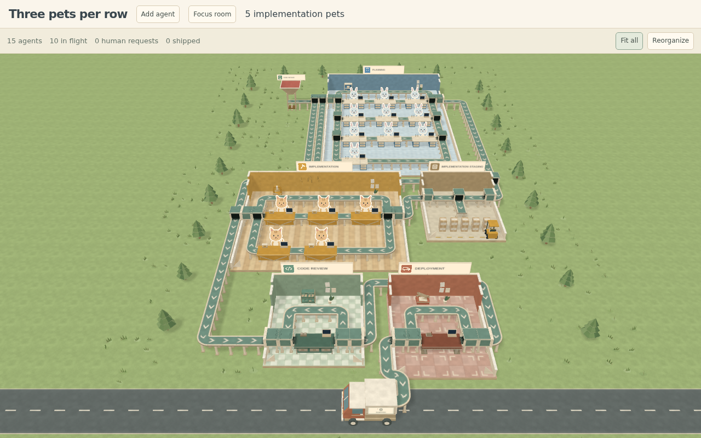
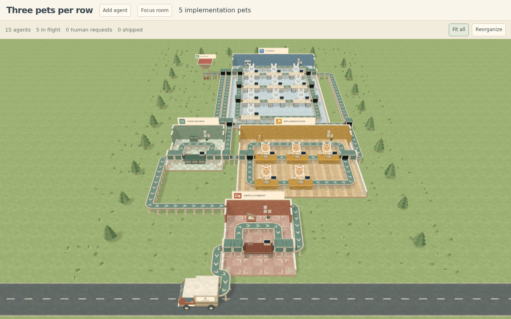

# Staging room verification

The staging browser fixture uses ten planners, five implementers and ten
unassigned tasks ready for Implementation. The queued view shows the staging
room with paper walls, a billboard, side conveyor openings, a T-shaped spur,
five floor stacks and one forklift. The drained view follows five assignments;
the other queued tasks are cancelled by the fixture. Staging disappears once
the five assigned boxes have landed, and neighboring rooms relayout.





Reproduce inside the devcontainer:

```sh
bun run smoke e2e/staging.spec.ts --workers=1
```

The second browser test exercises Planning → floor stack → forklift pickup →
Implementation. Unit coverage also checks the spur route, stable remaining
stack positions, serialized forklift pickups, multiple staging destinations,
queue retirement, growth and Reorganize.

Validation: 484 unit tests, both staging browser tests, TypeScript, demo build
and library build passed. Screenshots use Chromium software WebGL at 1280×800.
